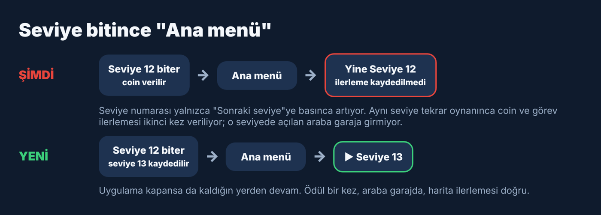
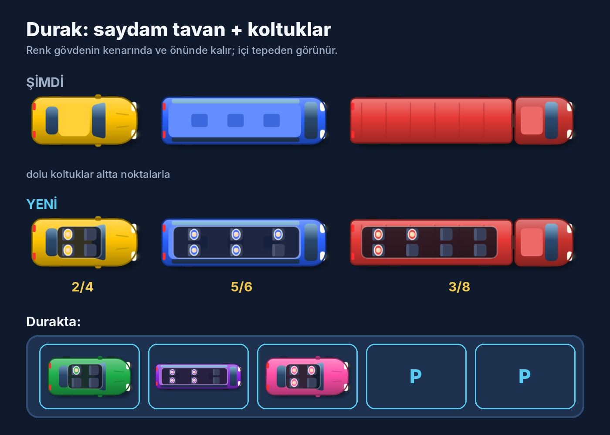
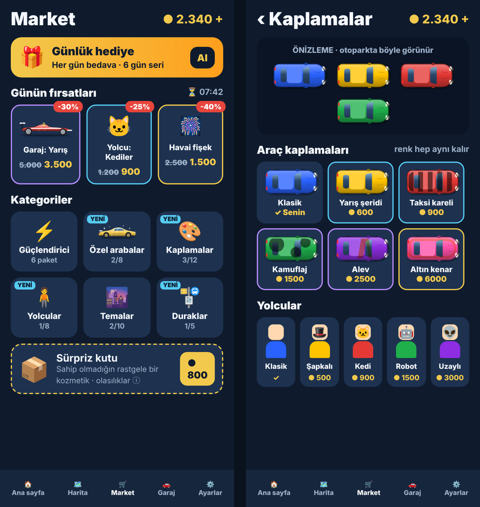

# Parxi — Geliştirme Planı: Market, Durak Koltukları, Kaldığı Yerden Devam

Durum: **geliştirildi (25 Kasım 2026).** Üç madde de tamam; market üç fazı birlikte yapıldı.

Uygulamada plandan farklar:
- Durakta araçlar dik (burnu yukarı) ve daha büyük çiziliyor; otobüs ve tır biraz kalınlaştırıldı ki koltuklar seçilebilsin. Ayrılan araç yukarı doğru çıkar.
- Kaplamalar tür × renk × kaplama olarak ayrı görsel üretildi (desen aracın kendi renginin açık/koyu tonu); toplam araç görseli ~3,8 MB.
- Günün fırsatları gün içinde sabit (satın alınca değişmez); sahip olunan fırsat "Senin" görünür.
- "Dene" düğmesi ve rozet ödülleri yapılmadı; önizleme ekranı aynı işi görüyor.

---

## 3. Seviye bitince "Ana menü" — kaldığı yerden devam (hata)

### Analiz
- `App.tsx` içinde seviye numarası (`progress.level`) yalnızca **"Sonraki seviye"** düğmesinde (`onNext`) artıyor.
- Seviye kazanılınca (`onLevelWin`) coin, yıldız, görev ilerlemesi ve harita ödülü veriliyor ama seviye numarası değişmiyor.
- Kazanma kartında "Ana menü"ye basınca (ya da uygulama o anda kapanırsa) oyuncu aynı seviyeye geri dönüyor.

### Yan etkileri (hatayı önemli yapan)
- Aynı seviye tekrar oynanınca **coin ve görev ilerlemesi ikinci kez** veriliyor (coin çoğaltma açığı).
- O seviyede açılan araba garaja **girmiyor** (garaj `progress.level - 1`'e bakıyor).
- Harita ilerlemesi ve kumbara yanlış görünüyor; başlangıç paketi teklifi gecikiyor.

### Çözüm
1. Seviye kazanıldığı anda `progress.level` artar (kazanma ödülleriyle aynı güncellemede).
2. Oyun ekranı oynanan seviyeyi kendi tutar: `screen = { kind: 'level', n }`. Böylece seviye numarası artınca ekran yeni seviyeye atlamaz, kazanma kartı görünmeye devam eder.
3. "Sonraki seviye": geçiş reklamı kuralı (aynen) → `screen.n = progress.level`.
4. "Ana menü": sadece ana sayfaya döner; ana sayfada "▶ Seviye 13" görünür.
5. Başlangıç paketi teklifinin zamanlaması kazanma anına taşınır.

### Test
- Kazan → Ana menü → ana sayfada bir sonraki seviye; garajda araba var; coin bir kez verilmiş.
- Kazan → uygulamayı kapat → aç: bir sonraki seviye.
- Kazan → Sonraki seviye: reklam kuralları aynı çalışıyor (11. seviyeden sonra, 3 seviyede bir).
- Harita son seviyesi: ödül bir kez.

**Tahmini iş:** küçük (yarım gün değil, ~1-2 saat) · Mağaza sürümü öncesi mutlaka yapılmalı.

---

## 2. Durakta saydam tavan + koltuklar

### Analiz
- Şu an duraktaki aracın doluluğu, aracın **altında küçük noktalarla** gösteriliyor. Küçük ekranda zor okunuyor.
- Araç çizimleri tek parça görsel (`assets/vehicles/*.png`); tavan kapalı.

### Çözüm
- **Yalnızca durakta** araçların tavanı saydam (koyu cam) olur; içi tepeden görünür. Otoparktaki araçlar kapalı kalır (otopark kalabalık, sade kalsın).
- Kabinde araç kapasitesi kadar **koltuk**: araba 2×2 = 4, otobüs 3×2 = 6, tır (dorse) 4×2 = 8.
- Yolcu bindikçe koltukta **tepeden yolcu** belirir (renkli omuz + kafa) ve küçük bir "yerine oturma" animasyonu oynar.
- **Renkler bozulmaz:** gövdenin kenarı, burnu, ön camı ve farları aracın kendi renginde kalır; saydam alan gövdenin içinde, kenardan payı bırakılmış bir pencere. Yolcu omuzları da aynı renkte olduğu için renk daha da belirginleşir.
- Market'teki araç stilleri (Parlak, Retro, Neon ve yeni kaplamalar) duraktaki araçta da görünür, çünkü koltuk katmanı görselin üstüne çizilir.
- Altındaki noktalar kalkar; yerine istenirse küçük "2/4" sayacı.

### Teknik
- Yeni görsel gerekmez: mevcut araç görseli + üstüne React Native ile kabin katmanı (koyu cam dikdörtgen + koltuk ızgarası + dolu koltuklarda yolcu). Kabin konumu türe göre sabit oran (araba gövdenin %24–66'sı, otobüs %7–84'ü, tır dorsesi %5–66'sı).
- Yolcu tepeden görünümü, market'teki yolcu görünümleriyle (şapka, kedi, robot…) uyumlu tasarlanır.
- Ayrılırken (araç dolunca) dolu koltuklarla yola çıkar.

### Test
- Her tür ve stilde koltuk sayısı doğru, dolum sırası doğru.
- Açık renkli (sarı, turkuaz) ve koyu renkli (mor, mavi) araçlarda renk kenardan rahatça okunuyor.
- iPad'de ve küçük telefonda koltuklar seçilebilir boyutta.

**Tahmini iş:** orta (~yarım gün).

---

## 1. Marketi çeşitlendirmek ve çekici yapmak

### Analiz (şimdiki durum)
- Satın alınabilen kozmetik sadece **7** tane: 4 tema + 3 araç stili. Gerisi güçlendirici paketi.
- Hepsi tek tip listede, önizleme yok, öne çıkan / indirimli / yeni ürün yok.
- Her gün markete girmek için bir sebep yok.
- Kazanılan coin: seviye başına ~25 (Zor seviye x2), Günlük Otopark 30, görevler ~100/gün, harita ödülleri 150–1.575. Aktif oyuncu günde ~300–500 coin kazanıyor → kozmetikler 1-3 günde bitiyor, sonra coin'in harcanacak yeri kalmıyor.

### Yeni market yapısı
**Ana ekran** (taslaktaki ilk görüntü):
1. **Günlük hediye** — her gün bedava (coin ya da güçlendirici, 7 günlük seride büyür). Günlük markete girme sebebi.
2. **Günün fırsatları** — her gün değişen 3 ürün, %20–40 indirim, geri sayım. Tarihten tohumla seçilir: sunucu gerekmez, herkese aynı.
3. **Kategoriler** (büyük ikonlu kartlar, az yazı, "YENİ" rozeti, sahip olunan/toplam).
4. **Sürpriz kutu** — sahip olunmayan rastgele bir kozmetik; yalnızca coin ile. Olasılıklar ekranda yazılı (Apple kuralı 3.1.1: coin gerçek parayla da alınabildiği için olasılık gösterimi zorunlu). Hepsine sahipsen kutu kapanır.

**Kategoriler ve içerik** (nadirlik çerçeveleri garajla aynı: Sıradan / Nadir / Destansı / Efsane):

| Kategori | İçerik | Fiyat aralığı (coin) |
|---|---|---|
| Güçlendiriciler | Mevcut 5 paket + "Mega paket" (en avantajlı rozeti) | 80–1.200 |
| Özel arabalar (garaj) | Seviyeyle açılmayan, yalnız market'te 8 araba: Elektrikli Mini, Safari Jip, Çöp Kamyonu, Vinçli Kamyon, Pizza Kuryesi, Altın Taksi, Ralli, Uzay Gezgini | 1.500–8.000 |
| Araç kaplamaları (otopark) | Klasik, Parlak, Retro, Neon + Yarış şeridi, Taksi kareli, Kamuflaj, Alev, Karbon, Ahşap panel, Puantiye, Altın kenar | 500–6.000 |
| Yolcular | Klasik + Şapkalı, Kedi, Köpek, Robot, Astronot, Uzaylı, Korsan | 500–3.000 |
| Temalar (otopark zemini) | Mevcut 5 + Kar, Çöl, Sahil, Uzay, Gece şehri | 600–2.500 |
| Duraklar | Klasik durak, Tramvay, Havalimanı kapısı, Kumsal, Kış | 800–2.000 |
| Kutlama efektleri | Konfeti, Havai fişek, Yıldız yağmuru, Balonlar (seviye sonunda) | 1.000–2.500 |

**Kurallar:**
- **Renk asla değişmez.** Kaplamalar aracın kendi renginin açık/koyu tonlarıyla desen ekler (şerit, kareli, alev); yolcu görünümleri gövdeyi yolcunun renginde bırakır. Oyunun okunabilirliği bozulmaz.
- Her kozmetiğin **önizlemesi**: kaplama otoparkta 4 renkte, yolcu durakta, tema küçük otoparkta (taslaktaki ikinci görüntü). "Dene" düğmesiyle tek seviye denenebilir.
- **Set ödülleri:** bir kategorinin hepsini toplayınca coin bonusu ve rozet.
- **Rozetler:** YENİ, %İNDİRİM, EN AVANTAJLI, SENİN, KULLANILIYOR.

### Ekonomi
- Fiyat bantları: Sıradan 400–800 · Nadir 900–2.000 · Destansı 2.500–5.000 · Efsane 6.000–12.000.
- Toplam kozmetik değeri ~120.000 coin: aktif oyuncu için aylarca hedef; coin paketlerine (IAP) doğal talep.
- Günün fırsatları ve günlük hediye her gün markete girme sebebi; kumbara ve başlangıç paketi aynen kalır.

### Teknik
- `core/market.ts`: ürün türleri genişler (`car`, `wrap`, `rider`, `theme`, `stop`, `fx`, `garageCar`, `booster`), nadirlik alanı, fiyat. Günün fırsatları ve sürpriz kutu saf fonksiyon (tohumlu) + testler.
- Kayıt (`Progress`): `cosmetics` yeni alanlarla (`rider`, `stop`, `fx`), `giftDay` / `giftStreak`, satın alınan özel arabalar.
- Görseller:
  - Kaplamalar: `scripts/make_vehicles.py`'ye desenler eklenir (araç × renk × kaplama). Dosya sayısı artacağı için desen üst katman olarak ayrı üretilip görselin üstüne bindirilir (renk başına değil, tür başına).
  - Özel arabalar: `scripts/make_cars.py`'ye 8 yeni model.
  - Yolcular, duraklar, efektler: React Native ile çizilir, ek görsel yok.
- Garaj: "Özel" rozetiyle market arabaları; seviyeyle açılanlardan ayrı bölüm.
- Analitik: `market_view`, `item_preview`, `item_buy`, `daily_gift`, `mystery_box` olayları (Firebase).

### Fazlar
1. **Market 1:** yeni ana ekran, günlük hediye, günün fırsatları, nadirlik ve rozetler, önizleme, mevcut ürünlerin yeni düzene taşınması.
2. **Market 2:** araç kaplamaları (8 yeni) + yolcu görünümleri (7 yeni).
3. **Market 3:** özel garaj arabaları (8), temalar (+5), duraklar (5), kutlama efektleri (4), sürpriz kutu, set ödülleri.

**Tahmini iş:** büyük (Market 1: ~1 gün, Market 2: ~1 gün, Market 3: ~1,5 gün).

---

## Yayın notları
- Mağaza ekran görüntüleri market ve durak değişince yeniden üretilir.
- Gizlilik beyanı değişmez (yeni veri toplanmıyor).
- Sürpriz kutu: App Store incelemesinde olasılıklar ekranda görünür olmalı.
